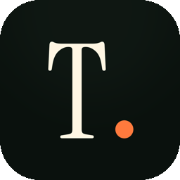
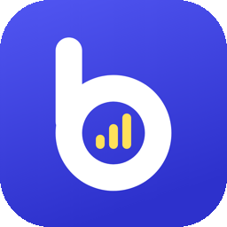
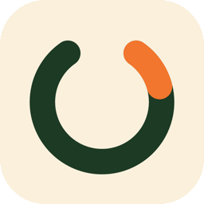
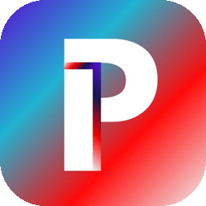

<h1 align="center">Abdulla Ehsan</h1>

  <b>Data Analytics & AI Engineer</b> &nbsp;|&nbsp; Data Visualisation &nbsp;|&nbsp; Shipping AI Products &nbsp;|&nbsp; Dubai, UAE

  
  
  

---

### About Me

I turn data into clear decisions. My work sits where analytics, visualisation and AI meet. I build data pipelines and dashboards, design visualisations that make complex data readable, and ship AI products from first idea through to a live release.

- Data analytics and AI engineer based in Dubai, working across analytics, visualisation, automation and applied AI.
- I ship end to end and have taken AI products all the way to live release.
- BSc Computer Science (Data Science), Monash University. CS50, Harvard.

### Apps I've Shipped

Designed, built and released by me, on iPhone and Android.

<table>
  <tr>
    <td width="96" align="center"></td>
    <td><b><a href="https://apps.apple.com/app/id6758775574">TOGA: Gym Workout & Calorie AI</a></b> A calorie counter, workout tracker and AI coach in one. Log a meal with a photo, train with a program built around your week, and ask a coach that knows your data.  </td>
  </tr>
  <tr>
    <td width="96" align="center"></td>
    <td><b><a href="https://play.google.com/store/apps/details?id=com.sakinaquran.app">Quran: Memorize, Learn & Audio</a></b> The Quran with its meaning, recitation and a story for every surah. Learn to read Arabic, memorize, and pray on time. Free, no ads.  </td>
  </tr>
  <tr>
    <td width="96" align="center"></td>
    <td><b><a href="https://apps.apple.com/app/id6821348012">Bandwise: Speaking & Writing</a></b> IELTS speaking and writing practice. Answer out loud or on the clock, and an AI examiner marks it in seconds against the band descriptors.  </td>
  </tr>
  <tr>
    <td width="96" align="center"></td>
    <td><b><a href="https://apps.apple.com/app/id6763267569">Forge: Quit Vaping & Drinking</a></b> Helps people quit vaping, drinking, smoking, weed or gambling, with a sober day counter, urge tools for the worst 20 minutes, and a private AI recovery coach.  </td>
  </tr>
  <tr>
    <td width="96" align="center"></td>
    <td><b><a href="https://apps.apple.com/app/id6746690850">Pledge: Habit & Urge Tracker</a></b> Break a habit one day at a time: a daily pledge, a one-tap SOS when an urge hits, and progress told as a story.  </td>
  </tr>
</table>

### Tech Stack

  
  
  
  
  
  
  
  
  
  
  
  

### Featured Projects

- **[Perpetual Futures Quant Lab](https://github.com/AbdullaE100/perp-quant-lab):** A Binance perpetual-futures trading bot with out-of-sample backtesting and quantitative strategy research.
- **[Explainable AI for Multimodal Sentiment Analysis](https://github.com/AbdullaE100/NEW-MMSA):** A platform that fuses text and image data using explainable AI. Nominated for Best Final-Year Project at Monash University.
- **[Email Management System](https://github.com/AbdullaE100/Email-Management):** A versatile email management application built in C++.

---

<i>Open to opportunities in data analytics, visualisation and AI.</i>

